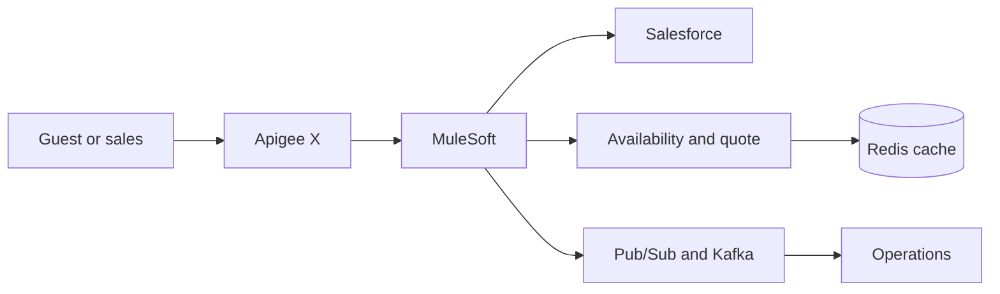

<!-- AI RETRIEVAL HINTS:
- Purpose: Landing page for the Hotel Events Planning repository. Routes readers to the wedding-inquiry specs, architecture, security, apps, and Terraform.
- Questions Answered: What is this repo? Where does a wedding inquiry go? Which document should I open next?
- When to Retrieve: First orientation for a new contributor or agent. For component detail, follow the links instead of expanding this file.
- When NOT to Retrieve: Implementing a single service, changing Terraform, or answering an interview question. Use the linked doc for that domain.
-->

# Hotel Events Planning

A mock hotel platform for one customer journey: a couple asks to hold wedding dates, sales qualifies the request, the hotel checks the venue and packages, and a confirmed booking is handed to operations.

The repository is a learning and reference implementation. It shows how a hospitality business can connect CRM, an API gateway, integration, event streams, cache, and cloud infrastructure. It is not a production property-management system.

## Journey

1. A prospect submits a wedding inquiry.
2. Salesforce holds the customer, lead, and opportunity.
3. Apigee X authenticates the call, applies quota and spike arrest, and routes it.
4. MuleSoft validates and normalizes the request.
5. Availability, rooms, catering, and price are checked. Redis may serve a cached answer. The booking record lives elsewhere.
6. Pub/Sub or Kafka carries the inquiry, quote, booking, and operations handoff.
7. A quote returns to sales. Confirmation notifies the hotel teams who will run the event.
8. OpenTelemetry and GCP Monitoring follow the request from the edge to the handoff.

Canonical detail: [project specs](DOCUMENTATION/INTERNAL/spects.md) and [architecture overview](DOCUMENTATION/INTERNAL/ARCHITECTURE/architecture-overview.md).

## Stack

| Concern | Choice |
| :--- | :--- |
| CRM and sales pipeline | Salesforce |
| Northbound API gateway | Apigee X |
| Orchestration | MuleSoft |
| Asynchronous work | Google Cloud Pub/Sub and Kafka |
| Cloud and infrastructure as code | Google Cloud Platform, Terraform, Terragrunt |
| Cache | Redis / Memorystore |
| Observability | OpenTelemetry and GCP Monitoring |
| Delivery | GitOps across DEV, TEST, STAGING, and PROD |

Current implementation focus is DEV. Later environments keep the same shape and add stricter promotion gates.

## Repository map

| Path | What it holds |
| :--- | :--- |
| [Agents.md](Agents.md) | Operating guide for contributors and coding agents |
| [AI_MANIFEST.toml](AI_MANIFEST.toml) | Machine index of the knowledge base |
| [DOCUMENTATION/INTERNAL/](DOCUMENTATION/INTERNAL/README.md) | Specs, architecture, security, glossary, and practice material |
| [APPS/](APPS/SALESFORCE/README.md) | Salesforce, Apigee, MuleSoft, Kafka, and Redis boundaries |
| [PLATFORM/PROVIDERS/GCP/TERRAFORM/](PLATFORM/PROVIDERS/GCP/TERRAFORM/README.md) | GCP Terraform, including the Apigee X module |
| [AGENTS/PLANNING/](AGENTS/PLANNING/PRODUCT-ROADMAP/README.md) | Product roadmap and storage strategy |
| [AGENTS/SKILLS/](AGENTS/SKILLS/MAIN-PROJECT-SKILL/skill.md) | Project, interview-prep, and documentation skills |
| [TROUBLESHOOTING/](TROUBLESHOOTING/troublemaker/incidents/README.md) | Failure drills and incident notes |

## Boundaries

- Salesforce is the sales and customer boundary, not the source of truth for inventory or the final booking.
- Apigee is the only northbound door for external API clients.
- Redis stores cached availability, pricing summaries, and temporary session data. It is not the system of record.
- Event payloads are versioned contracts. They are not the transactional database.
- The customer landing page is a reference design. It is not deployed from this repo.
- Secrets stay out of Git.

Security rules: [security.md](DOCUMENTATION/INTERNAL/security.md).

## People using AI agents

Sales and other hotel roles may already use one or more AI agents. Those agents are clients of the same APIs and events. A hotel turns connections on per role. Quote send, booking confirmation, price overrides, and guest messages still require a person.

Connection catalog: [ai-agent-connections.md](AGENTS/PLANNING/PRODUCT-ROADMAP/ai-agent-connections.md).

## Start here

1. Read [Agents.md](Agents.md) for how work in this repo is scoped.
2. Read [spects.md](DOCUMENTATION/INTERNAL/spects.md) for the wedding inquiry and its assumptions.
3. Read [architecture-overview.md](DOCUMENTATION/INTERNAL/ARCHITECTURE/architecture-overview.md), then [architecture.md](DOCUMENTATION/INTERNAL/ARCHITECTURE/architecture.md) if you are changing a boundary.
4. Open the app or platform README for the component you are touching.
5. Use [roadmap.md](DOCUMENTATION/INTERNAL/roadmap.md) and [practice-lab.md](DOCUMENTATION/INTERNAL/practice-lab.md) when the goal is to learn the flow by building a small piece of it.

## What is in the tree today

Documentation, planning, Salesforce object notes, an Apigee X Terraform module with a sample proxy, and a small Redis service sketch are in the repository. MuleSoft flows, Kafka topics, and the full booking path are specified and still being built. Treat missing services as design boundaries, not as running dependencies.
